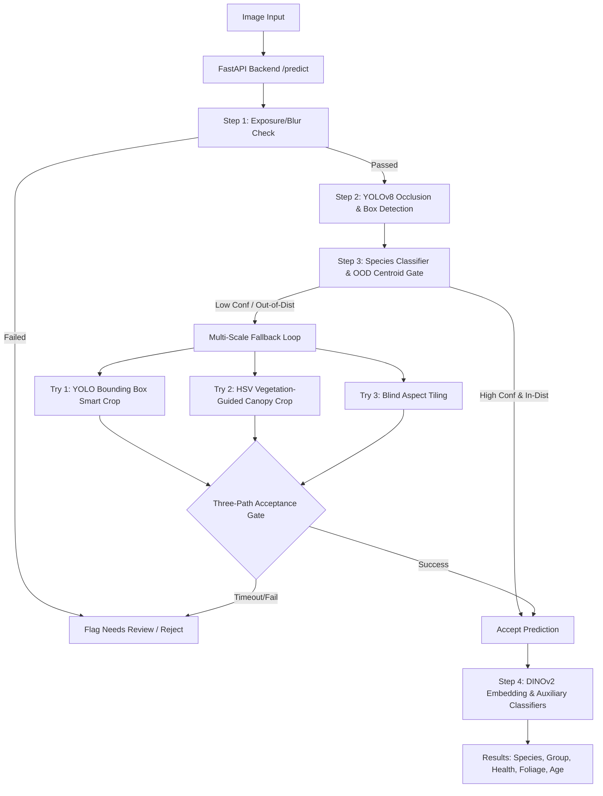

# TreeVision AI — Species Classification & Canopy Analysis Engine

TreeVision AI is a full-stack system designed to automate tree species identification, canopy quality audit, and auxiliary metric predictions (health, foliage, age) from urban street-view photos and remote samples. It is engineered with robust out-of-distribution (OOD) guarding and multi-scale fallback handlers to handle challenging real-world shooting distances and background clutter.

---

## 1. Project Architecture

The system splits functionality between a high-performance Python ML backend and a modern React/Next.js dashboard.



---

## 2. Setup & Running Instructions

### Backend Setup (FastAPI Server)
1. Navigate to the project root and activate the Python virtual environment:
   ```bash
   .venv\Scripts\activate
   ```
2. Install dependencies:
   ```bash
   pip install -r backend/requirements.txt
   ```
3. Run the uvicorn development server:
   ```bash
   python -m uvicorn backend.app:app --reload --port 8000
   ```
4. Verify the backend health:
   ```bash
   curl http://localhost:8000/health
   ```

### Frontend Setup (Next.js Dashboard)
1. Install Node dependencies:
   ```bash
   npm install
   ```
2. Start the Next.js development server:
   ```bash
   npm run dev
   ```
3. Open [http://localhost:3000](http://localhost:3000) in your browser.

---

## 3. Sample API Outputs

Below are examples of JSON outputs served by the endpoint `POST /predict`.

### Case A: Distant-Shot Rescued via Vegetation-Guided Crop (In-Distribution)
```json
{
  "species": "Pongamia_pinnata",
  "raw_species": "Pongamia_pinnata",
  "confidence": 88.42,
  "species_group": "broadleaf",
  "health": "Healthy",
  "age": "Maturing (10-30yr)",
  "foliage": "Full Canopy",
  "image_quality": "clear",
  "occlusion": "None",
  "needs_review": true,
  "top_predictions": [
    {"species": "Pongamia_pinnata", "confidence": 88.42},
    {"species": "Dalbergia_sissoo", "confidence": 4.12}
  ],
  "processing_time_ms": 1240,
  "ood_check": {
    "nearest_known_species": "Pongamia_pinnata",
    "similarity": 0.985,
    "runner_up_species_gap": 0.31,
    "is_recognized_species": true
  },
  "used_cropped_region": true
}
```

### Case B: Out-of-Distribution (OOD) Input Rejected
```json
{
  "species": "Unrecognized — not one of the trained species (closest match: Lantana_camara, 0.48 similarity)",
  "raw_species": "Unrecognized",
  "confidence": 48.00,
  "species_group": "unknown",
  "health": "Healthy",
  "age": "Maturing (10-30yr)",
  "foliage": "Full Canopy",
  "image_quality": "clear",
  "occlusion": "None",
  "needs_review": true,
  "top_predictions": [],
  "processing_time_ms": 940,
  "ood_check": {
    "nearest_known_species": "Lantana_camara",
    "similarity": 0.48,
    "runner_up_species_gap": 0.12,
    "is_recognized_species": false
  },
  "used_cropped_region": false
}
```

---

## 4. Key Assumptions & Known Limitations

Detailed reports are available in [docs/assumptions.md](file:///C:/Users/AYAN/Flocard%20Tree%20AI/docs/assumptions.md).

* **Species Count (25 exact species)**: The classifier tracks exactly 25 trained species mapped to 5 taxonomic categories.
* **Citizen-Science Data Bias (Distant Photo Failures)**: HSV analysis run across all training assets revealed that 7 species have a vegetation-fraction > 0.55 (representing tight, close-up documentation of leaf clusters rather than whole-tree views). The classifier struggles on whole-tree views of these 7 species due to this training data gap. The OOD gate and multi-scale fallback are specifically tuned to safely routing these cases to review rather than making confident false-positives.

---

## 5. Customization & Scaling

### Adding New Species Classes
1. **Extend Head**: Re-run training with your new images in `data/` and adjust the classification head size.
2. **Re-generate Centroids**: Run DINOv2 embedding extraction on your new training set, calculate class means, and save the updated pickle mapping to `backend/weights/species_centroids_data.pkl` so the OOD nearest-neighbor comparator stays aligned.

### Production Scaling
* **Async Workers**: Transition CPU/GPU-heavy requests from the synchronous FastAPI thread pool to an asynchronous queue system (e.g. **Celery with Redis/RabbitMQ**).
* **Batch Processing**: Group multiple images uploaded in batch jobs to utilize GPU parallelism during DINOv2 embedding extraction and EfficientNetV2 inference.
